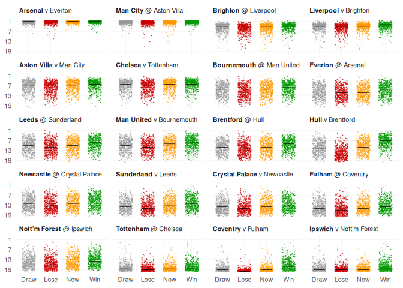

<!-- README.md is generated from README.Rmd. Please edit that file -->

## Predicting this season’s Premier League

    ## Rows: 40759 Columns: 12
    ## ── Column specification ────────────────────────────────────────────────────────
    ## Delimiter: ","
    ## chr (8): location, outcome, team_mid, opponent_mid, desc_position, desc_loca...
    ## dbl (4): position, weight, median_now, median_outcome
    ## 
    ## ℹ Use `spec()` to retrieve the full column specification for this data.
    ## ℹ Specify the column types or set `show_col_types = FALSE` to quiet this message.

    ## Warning: Removed 1013 rows containing missing values or values outside the scale range
    ## (`geom_point()`).

<!-- -->
